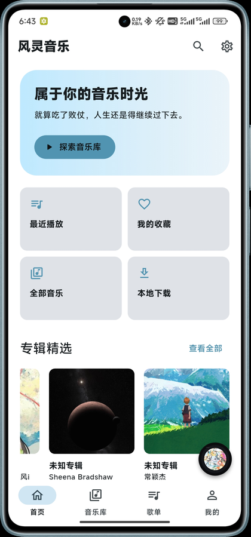
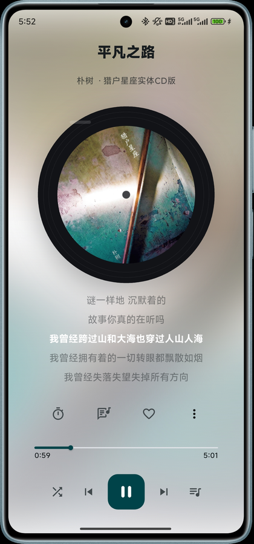

  

<h1 align="center">风灵音乐 · Sylphy Music</h1>

  你的音乐，自由聆听。 
  完全开源免费的多音源音乐播放器

  
  
  
  

  
  
  

音乐首页 · 沉浸播放 · 歌单封面流

收藏可以散落各处，喜欢始终在一起。风灵音乐不提供在线曲库，它把你自己已经拥有的音乐接进同一个音乐库：Emby、Navidrome、OpenSubsonic、WebDAV 服务器，或者硬盘与手机里的音乐文件夹。同一套浏览、搜索、歌单与播放体验，横跨 Android 与 Windows。

## 核心能力

### 一个音乐库，容纳所有来源

多个服务器、多个账号、本地珍藏，在同一个界面里浏览歌曲、专辑与艺术家。可按来源筛选、搜索与排序；不想见的歌曲加入黑名单后从浏览和搜索中隐藏，随时可以撤销。每个来源保留自己的身份、凭据与索引，互不串用。

### 沉浸播放，细节到位

播放页就是舞台：黑胶唱片或方形封面缓缓旋转，歌词逐行高亮并跟随播放滚动，点击任意一行即可跳转。菜单里的「歌曲信息」把曲目、音频参数、文件与来源分组列出，文件路径可以一键复制。随机与循环模式、播放队列、拖动进度、倍速播放、ReplayGain 响度调整与睡眠定时都在手边。

播放页还可以自己编排——封面、歌词、进度条与控制按钮可以放到画布上的任意位置，宽屏与竖屏各存一套。删空布局后菜单仍然可用，随时进编辑器恢复。

### 离线缓存，把音乐留在身边

为单曲或整个歌单安排缓存任务，查看进度，暂停、继续、取消或重试。只有完整下载并通过校验的文件才会被标记为已缓存，残片不会被当作离线可用；已缓存的音乐在断网后照样能听。

### 歌单与收藏

本地收藏与本地歌单可以混合多个来源。云歌单绑定单一来源，与服务器同步时保留基线、冲突备份与写入意图，宁可让你决定，也不盲目重放；重复歌曲按原样保留。WebDAV 连接使用本地收藏与歌单，不向服务器写入。

### 听音乐，也听自己的

深浅主题、自定义主色、首页背景图、封面形状与唱片旋转、完整歌词与迷你歌词字号……默认主色 `#5094B2`，其余交给你。全局封面可以统一成方形或黑胶唱片，Android 手势条透明沉浸，桌面宽屏自动切换侧栏。

### 平台原生体验

Android 提供媒体通知、锁屏与耳机线控、音频焦点处理，以及独立的缓存与同步前台服务；Windows 接入系统媒体控制（SMTC）、媒体键和托盘。App 内的「设置 → 检查更新」按你的点击手动检查新版本，不主动联网。

### 隐私与安全

凭据存放在系统安全存储，不写进数据库，也不进入日志与播放地址。本地媒体服务只监听 `127.0.0.1`，用短期随机票据逐次校验来源。诊断日志默认关闭，由你主动开启、导出或分享；可选的在线歌词补充默认关闭，开启后也只发送歌曲标题、艺术家与专辑。

## 支持的音源

| 音源 | 接入方式 | 云歌单 |
|---|---|---|
| **Emby** | 服务器地址与账号，可选端口和反向代理路径 | 支持，遵循账号权限 |
| **Navidrome / OpenSubsonic** | 服务器地址与账号 | 支持，遵循账号权限 |
| **WebDAV** | 直接连接 NAS 或网盘的音乐目录 | 使用本地收藏与歌单 |
| **本地音乐** | Android 文件选择器，或桌面音乐文件夹 | 使用本地歌单 |
| **飞牛音乐（fnOS）** | NAS 上安装的飞牛音乐应用，首期接入 | 只读浏览 |

在线服务端不提供稳定身份时，修改地址需要另建来源，用来隔离旧的缓存与歌单。飞牛音乐的接入条件与限制见 [飞牛音乐说明](docs/FN_MUSIC.md)，WebDAV 的扫描范围见 [WebDAV 说明](docs/WEBDAV.md)。

## 下载

正式版发布在 [GitHub Releases](https://github.com/ymltsh/SylphyMusic/releases/latest)，也可以从 [官网](https://sylphy.ymltsh.com/) 下载。

| 平台 | 文件 | 适合 |
|---|---|---|
| Android | [sylphy-music-arm64-v8a.apk](https://github.com/ymltsh/SylphyMusic/releases/latest/download/sylphy-music-arm64-v8a.apk) | 大多数手机 |
| Android | [sylphy-music-armeabi-v7a.apk](https://github.com/ymltsh/SylphyMusic/releases/latest/download/sylphy-music-armeabi-v7a.apk) | 32 位 ARM 设备 |
| Android | [sylphy-music-x86_64.apk](https://github.com/ymltsh/SylphyMusic/releases/latest/download/sylphy-music-x86_64.apk) | 对应设备与模拟器 |
| Windows | [sylphy-music-setup.exe](https://github.com/ymltsh/SylphyMusic/releases/latest/download/sylphy-music-setup.exe) | 安装程序 |
| Windows | [sylphy-music-windows.zip](https://github.com/ymltsh/SylphyMusic/releases/latest/download/sylphy-music-windows.zip) | 便携版，解压即用 |

每个版本附带 `SHA256SUMS.txt`，可自行校验安装包。Linux 暂缓发布。Windows 安装包暂未代码签名，请从官方发布页获取，不要使用来源不明的副本。

## 快速开始

1. 下载并安装，打开风灵音乐。
2. 首次启动可以连接一个音乐源、导入本地音乐，也可以跳过引导稍后再设置。
3. 之后在「设置 → 音乐源管理」中添加、验证或停用来源，随时重新同步索引。
4. 底部导航为首页、音乐库、歌单、我的；桌面宽屏自动变成侧边栏。

Android 通过文件选择器导入的音频会复制到应用管理目录；桌面上的文件夹来源直接引用原始文件，重新扫描时按大小与修改时间增量更新。停用来源会暂停相关播放并保留索引、缓存与个人引用，重新启用时先验证账号再同步。

## 技术栈

| 领域 | 选择 |
|---|---|
| 界面 | Flutter 3.47 · Dart 3.13 · Material 3 |
| 音频播放 | media_kit / libmpv |
| 数据与索引 | SQLite，过滤、分组与分页在 SQL 完成 |
| 媒体传输 | 回环媒体代理，短期票据、Range 读取与完整校验 |
| Android | audio_service 媒体会话，缓存 / 同步前台服务 |
| Windows | 定制 Runner：SMTC、媒体键、系统托盘 |

## 项目文档

| 文档 | 内容 |
|---|---|
| [文档索引](docs/README.md) | 全部文档入口 |
| [开发与构建指南](CONTRIBUTING.md) | 环境、运行、编译、打包与私密联调 |
| [架构说明](docs/ARCHITECTURE.md) | 模块划分、数据流与生命周期 |
| [界面说明](docs/UI_REFRESH.md) | 导航、首页、播放器与外观范围 |
| [更新与发布流程](update.md) | 版本清单、打包与发布边界 |
| [进度与验收](docs/PROGRESS.md) | 最新验证证据与剩余工作 |
| [第三方许可证](docs/THIRD_PARTY_LICENSES.txt) | Dart 依赖与原生许可证 |

使用中遇到问题，可以到 [Issues](https://github.com/ymltsh/SylphyMusic/issues) 反馈；想参与改进，请先阅读[开发与构建指南](CONTRIBUTING.md)。反馈时请勿公开账号密码、私人服务器地址或私人曲库内容。

## 许可证

自有代码以 [MIT 许可证](LICENSE) 发布。原生 libmpv、FFmpeg 等第三方依赖遵循各自许可证，其分发义务不由 MIT 覆盖，详见[原生依赖记录](docs/NATIVE_DEPENDENCIES.md)。

一段旋律，也有自己的星轨。 
© 2026 Sylphy Music · <a href="https://sylphy.ymltsh.com/">官网</a> · <a href="https://github.com/ymltsh/SylphyMusic">GitHub</a> · <a href="LICENSE">MIT License</a>

