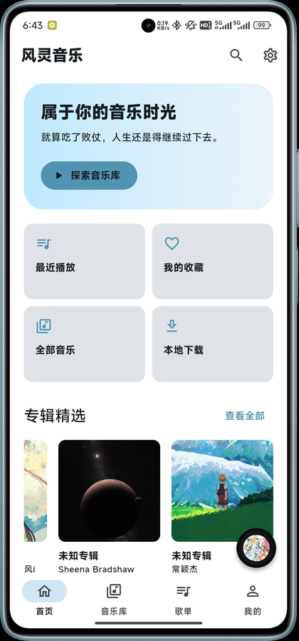
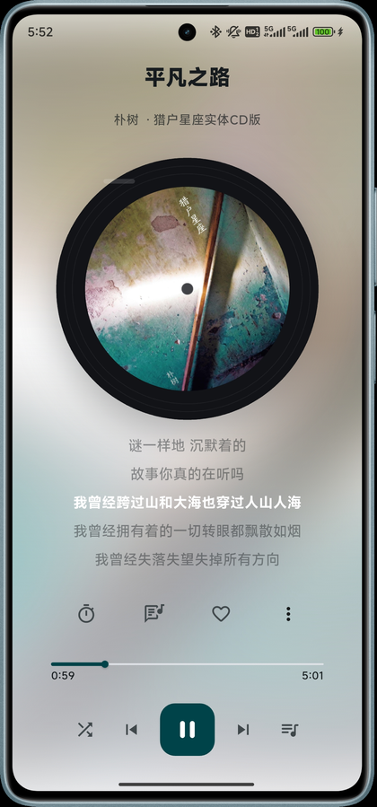
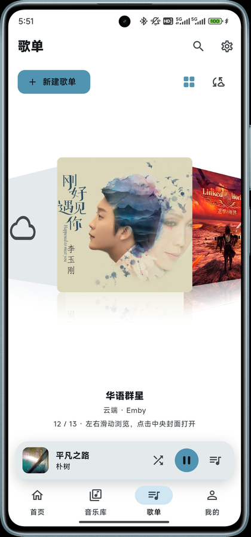

  

<h1 align="center">风灵音乐 · Sylphy Music</h1>

  <strong>念念不忘，必有回响。</strong> 
  让喜欢的角色，与你交换关于音乐的信。

  
  
  
  

  
  
  

音乐首页 · 沉浸播放 · 歌单封面流

风灵音乐是一款将**音乐与书信**结合的免费开源私人音乐播放器，支持 Android 与 Windows。你可以选择或创建角色，让 TA 成为音乐笔友：带着各自的故事、性格与审美，从你的音乐收藏中分享旋律，以来信、交流与可管理的记忆延续相处。

音乐是相遇的理由，书信让思念有了回声。我们希望保留的浪漫，可以是自由与远方，也可以是温柔与并肩；每位角色都可以有自己的表达方式，每次交流也可以只是一次真诚的分享。

播放器支持本地音乐、私人音乐服务器与 WebDAV 网盘目录，不提供在线曲库。**角色书信由可选的 LLM 服务驱动；即使不启用 AI，你依然拥有完整的私人音乐播放器。** 网盘扩展可通过官网提供的 OpenList Lite 特别版使用，具体支持以对应驱动为准。

## 核心能力

### 音乐笔友与角色书信

- **角色设定**：选择或创建音乐笔友，编辑名称、头像及 System / User 提示词；支持角色卡 JSON 导入与导出。角色保持独立身份，来信、聊天与记忆按角色管理。
- **音乐来信**：每日精选结合私人曲库候选与角色设定，生成带有标题、正文和逐曲分享理由的来信。模型只能从有效候选中选曲，不生成不存在的曲目，也不改变正在播放的队列。
- **交流与回响**：从当前或历史来信进入连续聊天，讨论选曲或分享想说的话；可选择保存交流，使真实互动成为后续选曲与写信的参考。
- **私人存档**：来信独立存档，可回看历史，也可导出或分享图片。记忆可以停止记录、关闭引用、逐项删除或清空，不把角色生成的推测当成用户经历。

角色书信与聊天需要用户配置兼容的 LLM 服务。关闭 LLM 或推荐请求失败时，播放器和本地推荐仍可使用；本地短笺与模型来信会标明来源。模型输出的内容与角色表现取决于所选服务和设定。

角色与记忆管理入口现提供独立聊天、角色状态、结构化记忆、世界书和轻量随机事件，无需先生成音乐来信。详见 [RP Core V21](docs/RP_CORE_V21.md)。升级到数据库 v21 会清空旧推荐、来信、笔友聊天、记忆、留言与推荐统计；保留音乐库、歌单、收藏、角色卡及配置，首次启动升级前请备份实际数据库。

v22 新增「角色日记与连续记忆」，可从 RP 管理页查看和编辑。已保存的对话会按批次、会话或日期边界使用现有 LLM 服务整理为日记，也可手动整理；整理可能产生额外模型费用。v21 升级至 v22 保留已有数据，详见 [RP Journal V22](docs/RP_JOURNAL_V22.md)。

来信、角色卡与聊天基础操作见[音乐笔友与来信存档](docs/PENPAL_RECOMMENDATIONS.md)、[角色卡](docs/CHARACTER_CARDS_V18.md)和[与笔友聊天](docs/PENPAL_CHAT.md)。

### 多来源音乐库

多个服务器、多个账号、本地珍藏，在同一个界面里浏览歌曲、专辑与艺术家。可按来源筛选、搜索与排序；不想见的歌曲加入黑名单后从浏览和搜索中隐藏，随时可以撤销。每个来源保留自己的身份、凭据与索引，互不串用。

### 播放与歌词

播放页就是舞台：黑胶唱片或方形封面缓缓旋转，歌词逐行高亮并跟随播放滚动，点击任意一行即可跳转。菜单里的「歌曲信息」把曲目、音频参数、文件与来源分组列出，文件路径可以一键复制。随机与循环模式、播放队列、拖动进度、倍速播放、ReplayGain 响度调整与睡眠定时都在手边。

播放页还可以自己编排——封面、歌词、进度条与控制按钮可以放到画布上的任意位置，宽屏与竖屏各存一套。删空布局后菜单仍然可用，随时进编辑器恢复。

### 离线缓存

为单曲或整个歌单安排缓存任务，查看进度，暂停、继续、取消或重试。只有完整下载并通过校验的文件才会被标记为已缓存，残片不会被当作离线可用；已缓存的音乐在断网后照样能听。

### 歌单与收藏

「设置 → 同步与收藏」可设置前台自动同步间隔和系统完成通知，并选择默认本地或云端收藏。Emby、Navidrome / OpenSubsonic 支持服务器收藏，其余来源继续使用本地收藏。

本地收藏与本地歌单可以混合多个来源。云歌单绑定单一来源，与服务器同步时保留基线、冲突备份与写入意图，宁可让你决定，也不盲目重放；重复歌曲按原样保留。WebDAV 连接使用本地收藏与歌单，不向服务器写入。

### 外观与布局

深浅主题、自定义主色、首页背景图、封面形状与唱片旋转、完整歌词与迷你歌词字号……默认主色 `#5094B2`，其余交给你。播放页编辑器中的每个封面可独立选择圆角、黑胶或沉浸样式，沉浸封面可调整矩形大小与边缘渐隐。升级到 v4 后需重新布置旧版播放页布局。Android 手势条透明沉浸，桌面宽屏自动切换侧栏。

Android 与 Windows 均支持桌面歌词，可在播放页“更多”或设置中的“歌词设置”开启，独立调整颜色和字号。Windows 歌词浮窗可拖动，主窗口最小化后仍保持显示。

### 平台原生体验

Android 提供媒体通知、锁屏与耳机线控、音频焦点处理，以及独立的缓存与同步前台服务；Windows 接入系统媒体控制（SMTC）、媒体键和托盘。App 内的「设置 → 检查更新」按你的点击手动检查新版本，不主动联网。

### 隐私与安全

凭据存放在系统安全存储，不写进数据库，也不进入日志与播放地址。本地媒体服务只监听 `127.0.0.1`，用短期随机票据逐次校验来源。诊断日志默认关闭，由你主动开启、导出或分享；可选的在线歌词补充默认关闭，开启后也只发送歌曲标题、艺术家与专辑。 原音源图片缺失时，默认启用在线封面兜底，只向 TheAudioDB / MusicBrainz 发送艺术家和专辑名，并从可信图片站点获取封面或头像，不发送服务器地址或登录凭据。

启用 LLM 后，推荐会向你配置的服务发送有限的候选音乐元数据、角色提示词与必要的偏好上下文；聊天会发送本轮消息，以及按设置附带的原信或历史记忆。推荐请求不上传音频文件、音源服务器地址或音源登录凭据。聊天内容与来信正文不进入诊断日志，LLM API Key 使用设备安全存储。关闭历史引用不等于停止当前聊天请求；数据处理与服务费用取决于你选择的服务提供方。配置与发送范围见 [LLM 说明](docs/LLM_RECOMMENDATION.md)和[聊天说明](docs/PENPAL_CHAT.md)。

## 支持的音源

| 音源 | 接入方式 | 云歌单 |
|---|---|---|
| **Emby** | 服务器地址与账号，可选端口和反向代理路径 | 支持，遵循账号权限 |
| **Jellyfin** | 服务器地址与账号，支持反向代理路径 | 只读浏览 |
| **Plex** | 服务器地址与已有访问令牌，播放原始音频 | 只读浏览 |
| **Navidrome / OpenSubsonic** | 服务器地址与账号 | 支持，遵循账号权限 |
| **WebDAV** | 直接连接 NAS 或网盘的音乐目录 | 使用本地收藏与歌单 |
| **本地音乐** | Android 文件选择器，或桌面音乐文件夹 | 使用本地歌单 |
| **飞牛音乐（fnOS）** | NAS 上安装的飞牛音乐应用，首期接入 | 只读浏览 |

在线服务端不提供稳定身份时，修改地址需要另建来源，用来隔离旧的缓存与歌单。飞牛音乐的接入条件与限制见 [飞牛音乐说明](docs/FN_MUSIC.md)，WebDAV 的扫描范围见 [WebDAV 说明](docs/WEBDAV.md)。

## 下载

正式版发布在 [GitHub Releases](https://github.com/ymltsh/SylphyMusic/releases/latest)，也可以从 [官网](https://sylphy.ymltsh.com/) 下载。

| 平台 | 文件 | 适合 |
|---|---|---|
| Android | [sylphy-music-arm64-v8a.apk](https://github.com/ymltsh/SylphyMusic/releases/latest/download/sylphy-music-arm64-v8a.apk) | 大多数手机 |
| Android | [sylphy-music-armeabi-v7a.apk](https://github.com/ymltsh/SylphyMusic/releases/latest/download/sylphy-music-armeabi-v7a.apk) | 32 位 ARM 设备 |
| Android | [sylphy-music-x86_64.apk](https://github.com/ymltsh/SylphyMusic/releases/latest/download/sylphy-music-x86_64.apk) | 对应设备与模拟器 |
| Windows | [sylphy-music-setup.exe](https://github.com/ymltsh/SylphyMusic/releases/latest/download/sylphy-music-setup.exe) | 安装程序 |
| Windows | [sylphy-music-windows.zip](https://github.com/ymltsh/SylphyMusic/releases/latest/download/sylphy-music-windows.zip) | 便携版，解压即用 |

每个版本附带 `SHA256SUMS.txt`，可自行校验安装包。Linux 暂缓发布。Windows 安装包暂未代码签名，请从官方发布页获取，不要使用来源不明的副本。

## 快速开始

1. 下载并安装，打开风灵音乐。
2. 首次启动可迁移旧设备配置、连接或导入音乐；随后在「念念不忘，必有回响（LLM 增强）」专页配置模型连接、选择音乐笔友并按需开启角色书信，也可稍后配置，再继续每日一言等其他 API 设置。
3. 之后在「设置 → 音乐源管理」中添加、验证或停用来源，随时重新同步索引。
4. 底部导航为首页、音乐库、歌单、我的；桌面宽屏自动变成侧边栏。

Android 通过文件选择器导入的音频会复制到应用管理目录；桌面上的文件夹来源直接引用原始文件，重新扫描时按大小与修改时间增量更新。停用来源会暂停相关播放并保留索引、缓存与个人引用，重新启用时先验证账号再同步。

### 可选：启用音乐笔友

1. 在「设置 → API 设置」配置兼容 Chat Completions 的 LLM 接口地址、模型与所需密钥。
2. 在「推荐设置」中启用 LLM 增强，并按需调整推荐参与方式、等待预算与角色提示词。
3. 打开每日精选查看来信，从来信菜单进入聊天；在角色与记忆管理入口调整角色设定、保存及引用范围。

LLM 服务可能收费，手动换新推荐或聊天也可能消耗额度。不启用这些功能不影响音乐播放。具体配置与当前限制以[推荐设置](docs/RECOMMENDATION_SETTINGS.md)及[文档索引](docs/README.md)为准。

## 技术栈

| 领域 | 选择 |
|---|---|
| 界面 | Flutter 3.47 · Dart 3.13 · Material 3 |
| 音频播放 | media_kit / libmpv |
| 数据与索引 | SQLite，过滤、分组与分页在 SQL 完成 |
| 媒体传输 | 回环媒体代理，短期票据、Range 读取与完整校验 |
| 角色书信 | 可选 Chat Completions 兼容服务、受限候选选曲、角色设定与本地存档 / 记忆 |
| Android | Media3 原生媒体会话 / libmpv，缓存 / 同步前台服务 |
| Windows | 定制 Runner：SMTC、媒体键、系统托盘 |

## 项目文档

| 文档 | 内容 |
|---|---|
| [文档索引](docs/README.md) | 全部文档入口 |
| [音乐笔友与来信](docs/PENPAL_RECOMMENDATIONS.md) | 来信生成、私人存档与图片导出 |
| [角色卡](docs/CHARACTER_CARDS_V18.md) | 角色身份、编辑、导入导出与独立记忆 |
| [LLM 配置与边界](docs/LLM_RECOMMENDATION.md) | 可选模型服务、元数据范围与本地回退 |
| [开发与构建指南](CONTRIBUTING.md) | 环境、运行、编译、打包与私密联调 |
| [架构说明](docs/ARCHITECTURE.md) | 模块划分、数据流与生命周期 |
| [界面说明](docs/UI_REFRESH.md) | 导航、首页、播放器与外观范围 |
| [更新与发布流程](update.md) | 版本清单、打包与发布边界 |
| [进度与验收](docs/PROGRESS.md) | 最新验证证据与剩余工作 |
| [第三方许可证](docs/THIRD_PARTY_LICENSES.txt) | Dart 依赖与原生许可证 |

使用中遇到问题，可以到 [Issues](https://github.com/ymltsh/SylphyMusic/issues) 反馈；想参与改进，请先阅读[开发与构建指南](CONTRIBUTING.md)。反馈时请勿公开账号密码、私人服务器地址或私人曲库内容。

## 许可证

自有代码以 [MIT 许可证](LICENSE) 发布。原生 libmpv、FFmpeg 等第三方依赖遵循各自许可证，其分发义务不由 MIT 覆盖，详见[原生依赖记录](docs/NATIVE_DEPENDENCIES.md)。

> 每一封信，都是别人重要的思念，不存在不必送达的信件。
>
> ——《紫罗兰永恒花园》

音乐与书信交织的浪漫，至死不渝。 
© 2026 Sylphy Music · <a href="https://sylphy.ymltsh.com/">官网</a> · <a href="https://github.com/ymltsh/SylphyMusic">GitHub</a> · <a href="LICENSE">MIT License</a>

聊天、每日精选与专辑精选现共用当前角色的连续记忆、日记和允许引用的上下文；已有推荐结果保留，手动换新或下一时段生成才使用新逻辑。详见 [RP 统一上下文 V22](docs/RP_SHARED_CONTEXT_V22.md)。
