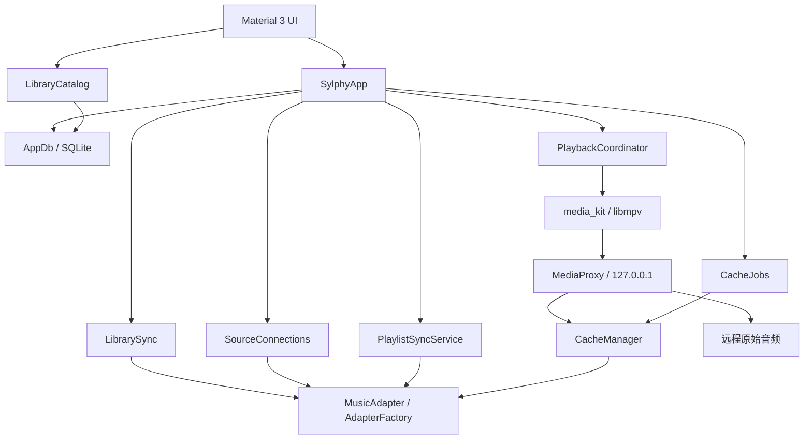

# 架构说明

本文描述当前代码。目标见 [产品规格](PROJECT_SPEC_v3.8.md)，实际验证和待办见 [PROGRESS](PROGRESS.md)。工程支持三端构建结构，Linux 本地原生验收目前暂缓。

## 结构与模块

图中展示主要调用和数据流；服务按需共享 `AppDb`。`SylphyApp.bootstrap()` 装配依赖，`disposeAsync()` 关闭资源，无额外依赖注入框架。封面和歌词通过控制器 / `ArtworkStore` 调用适配器，本地来源直接读取文件。

播放页另有展示层配置：`PlayerLayoutStore` 在现有 settings 中保存带版本的模板和当前选择，在数据库关闭前排空写入；`PlayerWidgetRegistry` 为编辑器与 `PlayerLayoutRenderer` 统一创建组件。编辑草稿与实际应用的布局隔离，预览控件不接收指针操作，正常渲染才向同一个 `PlaybackCoordinator` 发命令。播放页无顶栏；`PlayerQuickActions` 独立于用户配置，位于第一个可见进度条上方，没有进度条时显示底部回退行，删空布局后仍可进入编辑器恢复。实现、配置边界及验证入口见 [播放页布局编辑器](PLAYER_LAYOUT_EDITOR.md)。 默认与自定义播放页共用 `PlayerBackdrop`、`PlayerProgress` 和 `PlayerControls`；宽屏几何可独立保存为可选展示属性，竖屏坐标保留。主播放按钮宽高和按钮间距只影响展示，不创建新的播放实例或更改队列状态。

| 代码位置 | 职责 |
|---|---|
| `lib/main.dart` | Flutter / media_kit 初始化、主题和启动界面 |
| `lib/core/models.dart` | 身份、来源能力、曲目、歌单和队列快照 |
| `lib/core/app_controller.dart` | 服务装配及来源、导入、歌词、缓存等应用操作 |
| `lib/data/app_db.dart` | SQLite schema、迁移、事务、索引提交与持久化 |
| `lib/data/library_catalog.dart` | SQL 过滤、排序、分组、计数和有界分页 |
| `lib/services/sources.dart`、`webdav.dart`、`fn_music.dart` | 协议接口 / 工厂、安全存储、传输与适配器；WebDAV 和飞牛音乐是 sources 库的 part |
| `lib/services/library_sync.dart` | 逐页暂存、进度、取消、中断恢复和原子发布 |
| `lib/services/source_connections.dart` | 来源开关合并、重新验证与关闭验证中的连接 |
| `lib/services/cloud_sync.dart` | 云歌单基线、保守合并、冲突、写入意图 |
| `lib/services/playback.dart` | 队列、历史、状态、持久化、音频焦点和重连 |
| `lib/services/media_proxy.dart`、`byte_range.dart` | 回环票据、Range / HEAD、上游代理和缓存读取 |
| `lib/services/cache.dart`、`cache_jobs.dart` | TEMP / READY、摘要、租约、预取、LRU 和持久化任务 |
| `lib/services/local_library.dart`、`artwork.dart`、`lyrics.dart` | 本地导入和标签、封面缓存、LRC 解析 |
| `lib/services/desktop.dart`、`lib/ui/` | 桌面平台协调，以及库、歌单、来源、播放、缓存和设置页面 |

更新检查由 `AppUpdates` 处理，控制器提供 `checkForUpdates()` 入口，`AppUpdatePage` 仅在用户点击后调用。短生命周期 HTTP 客户端在每次检查结束后关闭，不加入后台同步或应用启动流程；版本来自安装包元数据。发布工具 / 清单和发布边界见 [更新与发布](../update.md)。

可选 `LrcApiClient` 由控制器装配给 `LyricsStore`，仅在本地 / 服务器歌词不可用时尝试在线补充，默认关闭。URL 与开关保存在 settings，独立鉴权密钥保存在 AuthVault；请求只包含歌曲标题、艺术家和专辑，不使用音源凭据。来源停用取消匹配请求，配置切换取消过期请求，`disposeAsync()` 在销毁 API 配置前关闭客户端，再由歌词服务等待读取结束。补充结果沿用每曲 MediaAssetStore 缓存与来源生命周期，详见 [在线歌词补充](LRC_API.md)。

## 身份与来源能力

`TrackRef(sourceId, id)` 唯一标识媒体，持久化 key 是二元数组 JSON。`sourceId` 为本机来源 UUID，账户间隔离。专辑 / 艺术家聚合只影响浏览，不改变身份。歌单 `entry_id` 独立于 TrackRef，重复歌曲保持重复。

| 来源 | 曲目 id | 索引 | 云歌单 | 歌词 / 封面 |
|---|---|---|---|---|
| Emby | 服务端 Item Id | 分页 Items 与媒体流等字段 | 支持，遵循账号权限 | 单曲 MediaStreams 的 text / lrc 字幕流；服务器图片 |
| OpenSubsonic | song id | 协议专辑 / 歌曲列表 | 支持，遵循账号权限 | 结构化歌词及兼容文本接口；封面接口 |
| 飞牛音乐（fnOS） | track guid | 分页 track/list | 只读浏览，保留重复歌曲 | lyric/list 与 static/cover 接口 |
| WebDAV | 根目录内编码相对路径 | Depth: 1 递归；文件名标题、目录分组 | 不支持；使用本地歌单 | 同名 LRC / TXT 和目录封面；已有完整缓存可读内嵌歌词 |
| 本地 | 规范化绝对文件路径 | 标签读取、目录增量扫描 | 不适用；使用本地歌单 | 内嵌图片 / 歌词、旁挂 LRC、手动导入 |

UI 和服务通过 `SourceKind.cloudPlaylists` 判断云歌单读取能力，新建 / 复制目标通过 `cloudPlaylistWritable` 判断写入能力；飞牛音乐首期只读，不能将所有远程来源都视为支持云歌单写入。飞牛接入地址以 `/music` 结尾，使用音乐应用独立账号，连接限制见 [FN_MUSIC](FN_MUSIC.md)。WebDAV 不在扫描时下载整首音频或解析远程内嵌标签，限制见 [WEBDAV](WEBDAV.md)。

## 索引与浏览

封面读取优先使用 Emby 单曲 `ImageTags.Primary` 对应的歌曲 ID 和 tag，再使用有 tag 的专辑 / 继承图片；只有 404 才尝试其他候选，不把鉴权失败当作缺图。URL 保留来源配置的反向代理前缀。封面磁盘与请求合并 key 包含图片版本，tag 更新后重新读取；失败请求不永久记忆，网络读取最多六路并发。

1. `LibrarySync` 记录来源扫描运行标记，适配器按页产生 Track。
2. 每页写入隔离的 `index_tracks`。Emby / WebDAV 按 250 首组织页，适配器负责完整遍历和协议校验。
3. 完整成功且来源配置有效时，事务合入新快照、软标记消失曲目并更新时间。
4. 失败和取消丢弃暂存，旧库继续可用。进程中断后启动清理残页，依据运行标记重新扫描，不续接半次分页。
5. `LibraryCatalog` 在 SQLite 过滤、排序和分组，常规页只加载 100 条完整元数据。播放全部读取 TrackRef 列表，当前曲目和可见队列行再查元数据。

本地目录由 `LocalLibrary` 独立扫描，按大小和修改时间复用未变化条目。Android 选择器导入音频复制到应用管理目录；桌面目录保留原始路径引用。

## 播放、代理与缓存

可选 Android 桌面歌词由 `AndroidDesktopLyrics` 监听既有播放与外观状态，复用应用歌词加载入口，通过 `music.sylphy/desktop_lyrics` 通道更新原生 `DesktopLyricsOverlay`。原生窗口由 Application 持有，复用现有 audio_service 引擎；用户授权悬浮窗后才显示，不创建第二个播放器。应用关闭时先移除监听、等待通道操作并隐藏悬浮窗，再关闭播放、歌词存储和数据库。Windows 不启用此 Android 服务。

播放失败通知由 `PlaybackNotice` 在应用根页面统一监听，以不阻断点击的浮动吐司显示，3 秒自动移除；恢复后提前收起，重复通知不排队。播放栏不常驻错误文字。播放器确认实际播放进度恢复时清空旧错误；失败后用户再次点击播放会重新加载媒体。

`PlaybackCoordinator` 解析队列中的精确身份。远程媒体取得短期票据后，由 libmpv 请求监听 `127.0.0.1` 的 `MediaProxy`。代理逐请求校验票据及来源，优先读取有效 READY，否则带来源凭据读取原始音频。票据不包含服务器密码。本地文件直接交给播放器。

代理处理 Range、后缀范围和 HEAD。播放捕获、主动整曲下载及提前预取由 `CacheManager` 协调。播放协调器按实际队列顺序预热后两首的封面和歌词，并顺序尝试完整音频缓存；列表循环可跨队尾，随机模式不猜测下一轮顺序，单曲循环不预取其他歌曲。完整文件仍须长度与摘要校验才能进入 READY。首个完整预取失败时回退到原有 P2 内存前缀机制：仅强 ETag 匹配时与余段复用，不进入 READY，也不跨进程保留。手动下载可接管同曲自动下载，队列计划变更只取消不再需要且未被用户接管的自动传输。

完整文件须确认完整长度、计算 SHA-256、同卷 rename 并写缓存记录。读取时核对资源元数据版本和文件完整性；稀疏文件 / 部分内容不能表示离线缓存。租约保护使用中的文件，删除或替换遵守释放边界；清理遵守 LRU、容量预算和磁盘安全余量。

`CacheJobs` 先保存歌单曲目快照，再调度下载。重建或取消不恢复半首歌曲为 READY。Android 下载使用独立 dataSync 前台服务，不借播放服务冒充下载任务。播放缓冲不足时后台任务让步；调度时序仍需压力验证。

## 自动同步与收藏

控制器按一分钟节拍检查前台到期音源，间隔可关闭或设为 5 / 15 / 30 / 60 / 360 / 1440 分钟，默认六小时。自动同步合并并发请求并限制失败重试频率，可选系统完成通知（Android 通知栏 / Windows 系统通知），不显示应用内弹条；退出取消节拍并等待在途任务后关闭数据库。

Navidrome / OpenSubsonic 红心通过 `getStarred2`、`star` / `unstar` 维护，按来源镜像到 `cloud-favorites:<sourceId>`，与跨来源本地收藏隔离。Emby 通过用户收藏列表及 `FavoriteItems` 接口分页读取、添加或取消收藏。默认收藏位置可选云端，其余来源仍用本地收藏。搜索、分组及推入的详情页面复用当前播放器的迷你播放栏。

## 歌单一致性

本地歌单可混合来源，云歌单绑定单一来源。同步保存已同步基线、本地草稿和最新远程状态，仅能证明安全的追加自动合并；删除、重排等冲突保留备份等待决定。

`sync_intents` 记录未决写入，避免服务器成功而响应丢失后重复追加。权限变化保留本地操作，写请求不按网络失败盲目重放。WebDAV 不参加云歌单同步，不执行远程文件写操作。

## 生命周期

- 停用来源：先 disabled，再暂停并失效匹配播放连接，取消索引、撤销代理票据 / 上游，停止封面和下载；保留索引、READY、个人引用与任务快照。
- 重新启用：先验证身份 / 认证，再持久化启用并索引；保持暂停，用户继续时重新打开媒体连接。
- 编辑连接：候选连接使用临时凭据命名空间。Emby 核对服务器和账号；Subsonic / WebDAV 无等价稳定身份，改变 URL 要添加独立来源。
- 删除来源：停止匹配工作，清除本机管理数据与凭据，不删除服务器音乐；与云歌单远程删除操作区分。
- 退出：依次关闭索引、来源验证、缓存任务、播放、代理、音频缓存、封面、歌词与媒体资源存储，最后关闭 SQLite。新增后台资源加入同一关闭链路。

## 封面与歌词资源

封面与远程歌词共用 MediaAssetStore，采用 SQLite 资源索引、不可变内容文件、本地优先与后台刷新。ArtworkStore / LyricsStore 管理协议和兼容旧文件，界面订阅资源版本变化。手动歌词独立固定，不参加普通 LRU；旧未区分来源的歌词保留恢复副本，迁移标记防止反复导入。细节与验证见 [媒体资源缓存](MEDIA_ASSETS.md)。

## 持久化

应用根目录是系统应用支持目录下的 `sylphy_music/`，测试可注入独立根目录。SQLite 当前版本 **6**，迁移由 `AppDb.open()` 负责。

| 表 / 位置 | 内容 |
|---|---|
| `sources`、`tracks` | 来源配置、曲目索引与 missing 软标记 |
| `index_runs`、`index_tracks` | 中断标记与暂存页 |
| `playlists`、`playlist_items`、`sync_intents` | 歌单、重复条目、同步基线和未决写入 |
| `blacklist`、`settings` | 黑名单、设置及队列等快照 |
| `cache`、`cache_jobs`、`cache_job_items` | 完整缓存、下载任务及其曲目状态 |
| `audio/ready/`、`audio/tmp/` | 完整音频与临时残片 |
| `covers/`、`artwork/`、`lyrics/`、`local/` | 远程封面、本地提取图片、歌词和导入文件 |
| media_assets / media_asset_migrations | 封面、歌词资源索引与旧文件迁移标记 |
| media_assets/objects/ / media_assets/tmp/ | 不可变资源文件和原子写入临时文件 |
| 系统安全存储 | `AuthVault` 管理 Token、密码及用户 / 服务器身份 |

SQLite 含来源地址和用户名等配置，不持久化密码 / Token。测试使用 `MemoryVault` 与临时根目录；私密联调从本机文件读取凭据，不编译到 APK。日志避免输出授权头、私有地址、私人曲目和歌词。

Emby 内嵌文本歌词优先请求带时间轴的 SRT，由 `services/lyrics.dart` 转换为毫秒精度 LRC，再交给统一歌词视图。服务器时间轴缓存与新手动导入分别使用 `.emby-timed-v2.lrc` / `.manual.lrc`，手动导入优先；旧 Emby 纯文本按需升级并保留原件为失败回退。旧有有效 LRC 不强制联网刷新。格式降级、旧版文件来源不明时的行为与验证见 [Emby 歌词](EMBY_LYRICS.md)。

## 平台与待完成边界

Android 以 `AudioServiceActivity` 承载媒体服务，另有缓存前台服务；Windows 定制 Runner 提供 SMTC / 媒体键 / 托盘。Linux Runner 和 CI 已准备，本机原生验收未完成。

`StrictTransport` 对安全读取有限重试，当前拒绝未经验证的重定向。合法签名播放跳转的完整兼容性仍是待办，不能简单开启自动跟随并转发凭据。WebDAV Basic 认证与文件名索引也不能称为全协议 / 全标签支持。

正式签名、libmpv / FFmpeg 对应源码与许可分发、物理设备焦点 / 后台场景及其他服务器兼容性继续按 [RELEASE_GATES](RELEASE_GATES.md) 验收。测试数量和最新平台结果只维护在 [PROGRESS](PROGRESS.md)，避免多份易过期数字。

## 界面与个性化

`SylphyShell` 提供首页、音乐库、歌单、我的四个主入口；宽屏切换为 NavigationRail。歌曲、专辑和艺术家成为音乐库内部分类，继续使用 SQL 分页与来源过滤。右上角进入设置，音乐源管理由设置打开。首次未配置来源且未跳过引导时展示欢迎页；是否显示引导取决于来源配置和 `ui_onboarded`，不取决于网络是否可用。

`QuickStartWizard` 管理欢迎、来源选择和公共 API 配置三步引导；公共配置通过 ApiSettings 校验与保存。`MusicSourcesPanel` 展示来源卡片和状态操作，`MusicSourceConnectionPage` 只收集并校验连接表单，将协议、URL 与独立凭据返回 Shell；实际登录、来源身份核对、前台同步与文件导入仍经 SylphyApp 原有入口。可选端口只修改 URI 的端口，保留反向代理路径；编辑已有来源不允许切换协议或账号。

引导只在保存引导配置时禁用导航，不等待来源连接 / 导入回调或全局 busy 状态清除。重复来源操作仍受互斥保护；同步 future 继续由 SylphyApp 持有，完成并离开引导不取消同步，也不改动应用关闭时等待任务的约定。

`Appearance` 在既有 settings 表存储主题模式、全局封面 / 唱片形状与旋转、完整歌词字号、迷你歌词字号、纯色背景、播放页封面模糊开关和实验性磨砂选项。`ListeningHistory` 监听播放器已经开始的播放，按 TrackRef 保存最近 50 首去重身份，串行写入 settings；恢复暂停队列不生成历史。读取历史时忽略已删除或停用来源，移除监听并等待待写任务后再关闭数据库。两者由 SylphyApp 装配和释放，不改变数据库版本或来源协议。

`HomePage` 只取 SQL 中最多 8 个专辑代表行，历史页面最多解析 50 个身份；不为首页加载完整曲库。迷你播放器与全屏播放页复用同一 PlaybackCoordinator。默认播放页与自定义模板统一为一份全画布 `PlayerLayout`：绝对坐标、可选独立宽屏坐标，没有封面 / 歌词 / 控制区域；`PlayerLayoutRenderer` 与编辑器共用同一组件注册表和实际窗口比例。`PlayerCover` 统一方形封面与黑胶唱片，形状和旋转来自全局 `Appearance`；RotatingCover 仅在可见、播放中且允许动画时旋转，不改变播放内核。完整歌词只有一个 `LyricsPage`，由播放页右向左滑动、歌词预览或菜单打开；`PlayerScene` 同时提供播放页内迷你歌词区的直接缩放手柄。布局 v1 的 JSON 在读取时迁移到 v2，settings key 不变；按钮圆角 / 宽度等仍作为布局属性保存。具体界面范围与保留项见 [UI_REFRESH](UI_REFRESH.md)、[播放页布局编辑器](PLAYER_LAYOUT_EDITOR.md)。

搜索使用独立 `SearchPage`，通过 CatalogQuery 复用 SQL 查询和曲目操作。主界面右上角进入搜索，原同步全部来源入口迁至音乐源管理。`LibraryBrowser` 的歌曲视图使用固定行高的虚拟列表，按可见位置加载每批 100 行，缓存最多六批并淘汰最久未用批次；查询或 catalogRevision 变化后递增请求代次，丢弃旧代次异步结果。歌曲、聚合专辑和艺术家均使用虚拟连续列表，不显示分页栏；播放全部和点播继续按完整查询获取身份队列，不限于已加载的元数据批次。

Android 系统栏由 `ui/system_bars.dart` 在应用启动和 MaterialApp.builder 中统一管理：edge-to-edge、透明导航栏与跟随主题的图标明暗；各页面分别处理安全边距，避免全局 SafeArea 造成背景断层或底部双倍留白。API 29+ 原生启动主题同步透明栏样式，详见 [Android 手势条说明](ANDROID_SYSTEM_BARS.md)。

自定义外观由 Appearance 持久化：主色默认 #5094B2，AppBackground 只包围一级页面，不覆盖设置、搜索和播放等次级路由。播放页使用 PlayerBackdrop，跟随 Theme.brightness 选择浅 / 深色封面取色和遮罩；纯色背景作为无封面模糊时的基础底色，封面模糊默认关闭。图片在应用数据目录存储受管副本，归一化、串行替换与关闭等待由 Appearance 管理；详见 [APPEARANCE](APPEARANCE.md)。

睡眠定时由 `SylphyApp.sleepTimer` 持有 `PlaybackSleepTimer`，不依赖播放页路由生命周期。使用应用会话内截止时间调用同一 `PlaybackCoordinator.pause()`，更换 / 取消定时清理旧任务，恢复前台复核截止时间；`disposeAsync()` 在关闭播放服务前取消并等待正在执行的定时任务，不保存跨进程定时设置。

WebDAV 的 `WebDavTags` 由 SylphyApp 共享给 ArtworkStore / LyricsStore：按来源、曲目、资源版本和代次合并有界 Range 读取，最多三个并发；完整缓存可离线提取，解析在 isolate 执行。内嵌封面与歌词优先于旁置文件，手动歌词仍最高；结果沿用 MediaAssetStore 原子落盘。停用来源取消匹配请求，应用退出先关闭标签生产者，再等待资源消费者并关闭数据库。目录同步仍只读取目录属性，不为标签遍历下载全库。

WebDAV 文本标签通过 WebDavTags.onTags 回调交给 AppDb 事务保存；SQLite v7 新增 webdav_track_tags，并为索引暂存补充 resource_version。commitIndex 仅合并匹配资源版本的标签，避免 PROPFIND 重扫覆盖已解析的艺术家 / 专辑。WebDavMetadataEnricher 在进程内按 50 首分页渐进补全，可见曲目优先，catalogRevision 最多每两秒通知；退出时先停止补全生产，再取消标签读取，等待遍历与可见任务后关闭 SQLite。

手动同步通过 SyncForeground / SyncForegroundService 管理 dataSync 通知与取消；Android 引擎由 audio_service 创建和正常销毁，SylphyApplication 获取该实例并注册同步 / 缓存 Channel。EngineLeaseManager 让同步与缓存各持独立租约，共用 AudioService 绑定，最后任务退出才解绑；不拦截引擎销毁或异步恢复缓存。普通暂停等待 Dart 清理回执，系统超时立即停服。Windows 同步复用相同业务入口，桥接不调用 Android Channel。退出等待前台同步 future 与标签遍历后关闭数据库；详见 [Android 同步服务](ANDROID_SYNC_FGS.md)。
