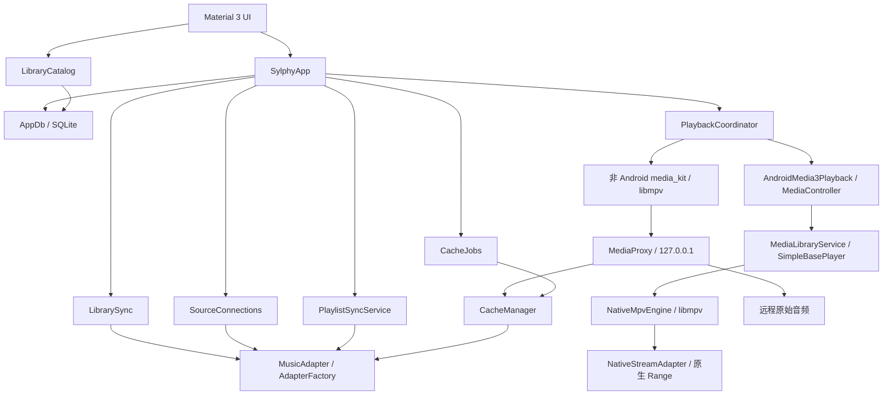

# 架构说明

本文描述当前代码。目标见 [产品规格](PROJECT_SPEC_v3.8.md)，实际验证和待办见 [PROGRESS](PROGRESS.md)。工程支持三端构建结构，Linux 本地原生验收目前暂缓。

## 结构与模块

图中展示主要调用和数据流；服务按需共享 `AppDb`。`SylphyApp.bootstrap()` 装配依赖，`disposeAsync()` 关闭资源，无额外依赖注入框架。封面和歌词通过控制器 / `ArtworkStore` 调用适配器，本地来源直接读取文件。

播放页另有展示层配置：`PlayerLayoutStore` 在现有 settings 中保存带版本的模板和当前选择，在数据库关闭前排空写入；`PlayerWidgetRegistry` 为编辑器与 `PlayerLayoutRenderer` 统一创建组件。编辑草稿与实际应用的布局隔离，预览控件不接收指针操作，正常渲染才向同一个 `PlaybackCoordinator` 发命令。播放页无顶栏；`PlayerQuickActions` 是支持移动、缩放、隐藏、删除和重新添加的独立快捷操作组件，保存手机 / 宽屏坐标且不跟随进度条。布局 v3 保留用户主动移除的状态，不再绘制回退操作行；旧 v1/v2 布局读取时迁移补齐快捷区。即使删除快捷区，也可从「设置 → 播放器外观 → 编辑播放页面」重新进入编辑器，无当前歌曲时同样可编辑。实现、配置边界及验证入口见 [播放页布局编辑器](PLAYER_LAYOUT_EDITOR.md)。 默认与自定义播放页共用 `PlayerBackdrop`、`PlayerProgress` 和 `PlayerControls`；宽屏几何可独立保存为可选展示属性，竖屏坐标保留。主播放按钮宽高和按钮间距只影响展示，不创建新的播放实例或更改队列状态。

| 代码位置 | 职责 |
|---|---|
| `lib/main.dart` | Flutter / media_kit 初始化、主题和启动界面 |
| `lib/core/models.dart` | 身份、来源能力、曲目、歌单和队列快照 |
| `lib/core/app_controller.dart` | 服务装配及来源、导入、歌词、缓存等应用操作 |
| `lib/data/app_db.dart` | SQLite schema、迁移、事务、索引提交与持久化 |
| `lib/data/library_catalog.dart` | SQL 过滤、排序、分组、计数和有界分页 |
| `lib/services/sources.dart`、`webdav.dart`、`fn_music.dart` | 协议接口 / 工厂、安全存储、传输与适配器；WebDAV 和飞牛音乐是 sources 库的 part |
| `lib/services/library_sync.dart` | 逐页暂存、进度、取消、中断恢复和原子发布 |
| `lib/services/source_connections.dart` | 来源开关合并、重新验证与关闭验证中的连接 |
| `lib/services/cloud_sync.dart` | 云歌单基线、保守合并、冲突、写入意图 |
| `lib/services/playback.dart` | 公共播放接口与非 Android 的 media_kit 实现 |
| `lib/services/android_media3_playback.dart` | Android Controller 网关、来源解析、缓存 / 封面业务及只读原生快照 |
| `android/.../playback/`、`playbackcore/`、`cpp/` | 单一原生队列、mpv、焦点、Media3 会话 / 通知与 Range 传输 |
| `lib/services/media_proxy.dart`、`byte_range.dart` | 回环票据、Range / HEAD、上游代理和缓存读取 |
| `lib/services/cache.dart`、`cache_jobs.dart` | TEMP / READY、摘要、租约、预取、LRU 和持久化任务 |
| `lib/services/local_library.dart`、`artwork.dart`、`lyrics.dart` | 本地导入和标签、封面缓存、LRC 解析 |
| `lib/services/desktop.dart`、`lib/ui/` | 桌面平台协调，以及库、歌单、来源、播放、缓存和设置页面 |

更新检查由 `AppUpdates` 处理，控制器提供 `checkForUpdates()` 入口，`AppUpdatePage` 仅在用户点击后调用。短生命周期 HTTP 客户端在每次检查结束后关闭，不加入后台同步或应用启动流程；版本来自安装包元数据。普通版读取 main/version.json；OpenList 正式更新读取 main/version-openlist.json，旧 feature/android-openlist-lite/version.json 保留兼容，测试入口仍独立。OpenList 客户端验证清单的特别版标识，避免把普通版附件作为特别版更新。发布工具 / 清单和发布边界见 [更新与发布](../update.md)。

可选 `LrcApiClient` 由控制器装配给 `LyricsStore`，仅在本地 / 服务器歌词不可用时尝试在线补充，默认关闭。URL 与开关保存在 settings，独立鉴权密钥保存在 AuthVault；请求只包含歌曲标题、艺术家和专辑，不使用音源凭据。来源停用取消匹配请求，配置切换取消过期请求，`disposeAsync()` 在销毁 API 配置前关闭客户端，再由歌词服务等待读取结束。补充结果沿用每曲 MediaAssetStore 缓存与来源生命周期，详见 [在线歌词补充](LRC_API.md)。

## 身份与来源能力

`TrackRef(sourceId, id)` 唯一标识媒体，持久化 key 是二元数组 JSON。`sourceId` 为本机来源 UUID，账户间隔离。专辑 / 艺术家聚合只影响浏览，不改变身份。歌单 `entry_id` 独立于 TrackRef，重复歌曲保持重复。

| 来源 | 曲目 id | 索引 | 云歌单 | 歌词 / 封面 |
|---|---|---|---|---|
| Emby | 服务端 Item Id | 分页 Items 与媒体流等字段 | 支持，遵循账号权限 | 单曲 MediaStreams 的 text / lrc 字幕流；服务器图片 |
| Jellyfin | 服务端 Item Id | 独立鉴权与分页 Items | 只读，保留重复条目 | 服务器结构化歌词及图片 |
| Plex | ratingKey | 各音乐 Section 分页曲目 | 只读，保留重复条目 | 同服务器图片；暂不读取服务器歌词 |
| OpenSubsonic | song id | 协议专辑 / 歌曲列表 | 支持，遵循账号权限 | 结构化歌词及兼容文本接口；封面接口 |
| 飞牛音乐（fnOS） | track guid | 分页 track/list | 只读浏览，保留重复歌曲 | lyric/list 与 static/cover 接口 |
| WebDAV | 根目录内编码相对路径 | Depth: 1 递归；文件名标题、目录分组 | 不支持；使用本地歌单 | 同名 LRC / TXT 和目录封面；已有完整缓存可读内嵌歌词 |
| 本地 | 规范化绝对文件路径 | 标签读取、目录增量扫描 | 不适用；使用本地歌单 | 内嵌图片 / 歌词、旁挂 LRC、手动导入 |

UI 和服务通过 `SourceKind.cloudPlaylists` 判断云歌单读取能力，新建 / 复制目标通过 `cloudPlaylistWritable` 判断写入能力；飞牛音乐首期只读，不能将所有远程来源都视为支持云歌单写入。飞牛接入地址以 `/music` 结尾，使用音乐应用独立账号，连接限制见 [FN_MUSIC](FN_MUSIC.md)。WebDAV 不在扫描时下载整首音频或解析远程内嵌标签，限制见 [WEBDAV](WEBDAV.md)。

## 索引与浏览

文件夹浏览按来源和完整路径保持身份，在 SQLite 中将每条已索引歌曲的目录投影为当前层直属子目录，同层直属歌曲与目录分开分组；查询与分页不加载全库 Track 元数据。初始节点是各来源内没有其他存歌祖先的实际存歌目录，跳过系统根目录与空的中间父目录；入口基于有效索引确定，不随搜索关键词改变。相对路径统一以 ./ 作为边界，直属源根目录的歌曲与相对路径子目录可在同一树中浏览。进入目录后继续逐层浏览，目录播放及批量操作按路径分隔边界包含子树，不使用可能误匹配通配符的 LIKE。无可用目录的曲目保留「未提供目录」分组，不虚构服务器目录。

艺术家行使用独立圆形头像。Emby / Jellyfin 按艺术家身份（旧索引可在同一来源内精确匹配艺术家名称）读取 Primary 图片；Plex 使用艺术家的 grandparentThumb，OpenSubsonic 使用艺术家 coverArt。艺术家分页在当前筛选范围内选择支持头像的来源作为图片代表，额外读取限于当前分页。头像沿用 ArtworkStore 的并发、来源取消和退出链路及 MediaAssetStore 的完整校验、配额和租约，缓存身份包含来源与艺术家，不覆盖歌曲 / 专辑封面关联；图片缺失时由在线兜底查询 TheAudioDB，仍无结果则显示默认头像。

Jellyfin / Plex 通过独立适配器接入既有索引、代理、缓存和媒体资源生命周期。Jellyfin 使用账号密码换取令牌并核对服务器 / 用户身份；Plex 使用已有访问令牌，绑定服务器 machineIdentifier，更换令牌须添加独立来源。Plex 媒体和封面仅接受同服务器相对路径，凭据只通过请求头传递；不支持账户 PIN 授权或转码。两者云歌单仅可读取，收藏使用本地能力。来源枚举追加成员，沿用数据库 v9，不迁移现有数据。来源 Logo 使用 assets/source/jellyfin.png 和 plex.png。

封面读取优先使用 Emby 单曲 `ImageTags.Primary` 对应的歌曲 ID 和 tag，再使用有 tag 的专辑 / 继承图片；只有 404 才尝试其他候选，不把鉴权失败当作缺图。URL 保留来源配置的反向代理前缀。封面磁盘与请求合并 key 包含图片版本，tag 更新后重新读取；失败请求不永久记忆，网络读取最多六路并发。

1. `LibrarySync` 记录来源扫描运行标记，适配器按页产生 Track。
2. 每页写入隔离的 `index_tracks`。Emby / WebDAV 按 250 首组织页，适配器负责完整遍历和协议校验。
3. 完整成功且来源配置有效时，事务合入新快照、软标记消失曲目并更新时间。
4. 失败和取消丢弃暂存，旧库继续可用。进程中断后启动清理残页，依据运行标记重新扫描，不续接半次分页。
5. `LibraryCatalog` 在 SQLite 过滤、排序和分组，常规页只加载 100 条完整元数据。播放全部读取 TrackRef 列表，当前曲目和可见队列行再查元数据。

本地目录由 `LocalLibrary` 独立扫描，按大小和修改时间复用未变化条目。Android 选择器导入音频复制到应用管理目录；桌面目录保留原始路径引用。

## 播放、代理与缓存

Android 由 `SylphyMediaLibraryService` 持有唯一的 `MpvMedia3Player` / libmpv context。通知、锁屏、耳机 / 蓝牙和 Flutter 界面都经同一 Media3 会话操作。`AndroidMedia3Playback` 实现公共 `PlaybackCoordinator` 接口，但不实例化父类的惰性 media_kit Player、不初始化 AudioHandler / Dart AudioSession，也不运行旧的通知时钟、EOF 推进或 AO 恢复定时器。非 Android 沿用原有 media_kit / 代理路径。

原生队列为每个条目保存独立 entryId，保留重复歌曲；精确资源身份仍是 TrackRef(sourceId, id)。播放意图、临时失焦、实际时间推进与缓冲分开建模，使用附件基础包的 Kotlin reducer。所有 JNI 访问在进程内同一工作线程串行执行，样本与命令带观察代次；新服务等待旧 context 销毁后才能创建。Media3 自己管理默认通知与前台服务，等待通知进入前台的完成回调后才申请焦点。用户 Pause、永久失焦、noisy 和过期来源解析不能被旧回调撤销。临时失焦最多保留五分钟；实际播放使用有时限并按状态续期的 partial WakeLock，暂停 / 失败 / 销毁释放。

原生每 200ms 观察 mpv 状态；准备、Seek 或停滞期间冻结系统时间线，实际推进后报告 READY，三秒无推进转缓冲，三十秒无推进转可重试错误，不自动跳过曲目。完整缓存与本地路径优先；原生 Range 转发由 NativeStreamAdapter 负责，来源 URL / headers 仅保存在其内存，TLS 使用平台默认校验，跳转限定同 scheme / host / port。在线地址与刷新仍由应用级 Flutter 业务引擎中的 MusicAdapter / AuthVault 解析，播放字节不经过 Dart MediaProxy。远程暂停后显式恢复会重新解析授权地址；完整缓存 / 本地输出长暂停后重开同曲并保留位置。

CacheManager 的 READY、长度 / SHA-256 校验、资源版本与统一空间额度保持不变。音频读取增加进程作用域的原生租约文件；清理、校验替换及配额淘汰共同尊重租约，只有确认旧 decoder idle 或销毁后才释放。Android 普通完整缓存下载仍由现有 fetchWhole 验证提交；当前曲目和后两首按原生队列顺序进行可取消的自动完整缓存、封面和歌词预热。原生播放与后台完整缓存各自读取上游，可能增加网络流量；部分 Range 数据不写成 READY，也不引入 SimpleCache。

通知封面复用 ArtworkStore，物化到专用 cache 目录后经只读 content FileProvider 提供，authority 随 applicationId 区分。Flutter 只采样 UI / 统计快照；队列仅在修订变化时传输，通知不依赖这个采样。重进界面读取现存服务，不用数据库旧快照覆盖；原生 checkpoint 原子保存队列、位置与本地路径，不保存 URL / headers，冷启动保持暂停。后台暂停时释放应用内部 Controller 绑定，由 Media3 管理前台降级。尚未实现全来源原生持久授权，因此不注册系统杀进程后的 MediaButtonReceiver / playback resumption，不宣称完整 Android Auto 曲库支持。详见 [本轮实施](MEDIA3_NOTIFICATION_IMPLEMENTATION.md) 与 [附件设计蓝图](ANDROID_MPV_MEDIA3_ARCHITECTURE.md)。

非 Android 原有 NativeCommandGate、回环短期票据、完整缓存优先与有界重连继续保留。旧 Android audio_service / Dart 投影与 AO 恢复设计记录保留为历史材料，不再描述当前 Android 执行路径。

推荐 V1 由 `RecommendationRepository` 在 SQL 内检索有界候选，`RecommendationEngine` 排序，`RecommendationService` 分别缓存每日 24 首混合与最多 8 张来源作用域专辑。SQLite v10 通过新增表 / 索引迁移保留 v9 数据；`ListeningAnalytics` 消费实际进度与完成 / 主动跳过边界，15 秒检查点串行落库，明细保留 90 天，累计统计长期保留。最近播放保存 1000 个去重身份并分批解析。来源移除清理相应统计、推荐及历史，退出先停止统计监听、等待推荐和统计任务，再关闭播放与数据库；关闭个性化后仍执行完整退出清理。公开热榜仅请求固定公共榜单，不上传个人曲库或播放记录；菜单可切换在线热度和个性化。详见 [推荐 V1](RECOMMENDATION_V1.md)。

## 自动同步与收藏

控制器按一分钟节拍检查前台到期音源，间隔可关闭或设为 5 / 15 / 30 / 60 / 360 / 1440 分钟，默认六小时。自动同步合并并发请求并限制失败重试频率，可选系统完成通知（Android 通知栏 / Windows 系统通知），不显示应用内弹条；退出取消节拍并等待在途任务后关闭数据库。

Navidrome / OpenSubsonic 红心通过 `getStarred2`、`star` / `unstar` 维护，按来源镜像到 `cloud-favorites:<sourceId>`，与跨来源本地收藏隔离。Emby 通过用户收藏列表及 `FavoriteItems` 接口分页读取、添加或取消收藏。默认收藏位置可选云端，其余来源仍用本地收藏。搜索、分组及推入的详情页面复用当前播放器的迷你播放栏。

## 歌单一致性

本地歌单可混合来源，云歌单绑定单一来源。同步保存已同步基线、本地草稿和最新远程状态，仅能证明安全的追加自动合并；删除、重排等冲突保留备份等待决定。

`sync_intents` 记录未决写入，避免服务器成功而响应丢失后重复追加。权限变化保留本地操作，写请求不按网络失败盲目重放。WebDAV 不参加云歌单同步，不执行远程文件写操作。

## 生命周期

设备间快速迁移由 `DeviceTransferConfig` 按白名单导出及合并手动配置，`DeviceTransferPage` 提供发送、配对、导入预览与确认，首次引导也可直接接收。`device_transfer_transport.dart` 使用页面作用域的 UDP 发现和临时 TCP 会话，X25519 / HKDF / AES-GCM 保护传输，双方人工核对配对码后发送数据；离开页面释放网络资源。凭据仅在迁移内存与安全存储间流转，不复制数据库、曲库或缓存。细节见 [设备间快速迁移](DEVICE_TRANSFER.md)。

- 停用来源：先 disabled，再暂停并失效匹配播放连接，取消索引、撤销代理票据 / 上游，停止封面和下载；保留索引、READY、个人引用与任务快照。
- 重新启用：先验证身份 / 认证，再持久化启用并索引；保持暂停，用户继续时重新打开媒体连接。
- 编辑连接：候选连接使用临时凭据命名空间。Emby 核对服务器和账号；Subsonic / WebDAV 无等价稳定身份，改变 URL 要添加独立来源。
- 删除来源：停止匹配工作，清除本机管理数据与凭据，不删除服务器音乐；与云歌单远程删除操作区分。
- 退出：依次关闭索引、来源验证、缓存任务、播放、代理、音频缓存、封面、歌词与媒体资源存储，最后关闭 SQLite。新增后台资源加入同一关闭链路。

## 封面与歌词资源

原音源封面缺失后，ArtworkStore 可自动在线补充艺术家头像 / 专辑封面，默认启用；独立 OnlineArtworkProvider 仅发送艺术家 / 专辑名，经 TheAudioDB、MusicBrainz / Cover Art Archive 匹配，沿用 MediaAssetStore 完整校验与缓存。在线查询具备来源取消与退出关闭边界，不携带音源凭据，不替代认证错误。详见 [在线封面兜底](ONLINE_ARTWORK.md)。

封面与远程歌词共用 MediaAssetStore，采用 SQLite 资源索引、不可变内容文件、本地优先与后台刷新。ArtworkStore / LyricsStore 管理协议和兼容旧文件，界面订阅资源版本变化。手动歌词独立固定，不参加普通 LRU；旧未区分来源的歌词保留恢复副本，迁移标记防止反复导入。细节与验证见 [媒体资源缓存](MEDIA_ASSETS.md)。

## 持久化

应用根目录是系统应用支持目录下的 `sylphy_music/`，测试可注入独立根目录。SQLite 当前版本 **16**，迁移由 `AppDb.open()` 负责。

| 表 / 位置 | 内容 |
|---|---|
| `sources`、`tracks` | 来源配置、曲目索引与 missing 软标记 |
| `index_runs`、`index_tracks` | 中断标记与暂存页 |
| `playlists`、`playlist_items`、`sync_intents` | 歌单、重复条目、同步基线和未决写入 |
| `blacklist`、`settings` | 黑名单、设置及队列等快照 |
| `cache`、`cache_jobs`、`cache_job_items` | 完整缓存、下载任务及其曲目状态 |
| `audio/ready/`、`audio/tmp/` | 完整音频与临时残片 |
| `covers/`、`artwork/`、`lyrics/`、`local/` | 远程封面、本地提取图片、歌词和导入文件 |
| media_assets / media_asset_migrations / cache_asset_links | 封面、歌词资源索引与旧文件迁移标记 |
| media_assets/objects/ / media_assets/tmp/ | 不可变资源文件和原子写入临时文件 |
| 系统安全存储 | `AuthVault` 管理 Token、密码及用户 / 服务器身份 |

SQLite 含来源地址和用户名等配置，不持久化密码 / Token。测试使用 `MemoryVault` 与临时根目录；私密联调从本机文件读取凭据，不编译到 APK。日志避免输出授权头、私有地址、私人曲目和歌词。

Emby 内嵌文本歌词优先请求带时间轴的 SRT，由 `services/lyrics.dart` 转换为毫秒精度 LRC，再交给统一歌词视图。服务器时间轴缓存与新手动导入分别使用 `.emby-timed-v2.lrc` / `.manual.lrc`，手动导入优先；旧 Emby 纯文本按需升级并保留原件为失败回退。旧有有效 LRC 不强制联网刷新。格式降级、旧版文件来源不明时的行为与验证见 [Emby 歌词](EMBY_LYRICS.md)。

## 平台与待完成边界

Android 使用标准 FlutterActivity、应用级业务引擎与独立 MediaLibraryService，另有缓存 / 同步前台服务；Windows 定制 Runner 提供 SMTC / 媒体键 / 托盘。Linux Runner 和 CI 已准备，本机原生验收未完成。

`StrictTransport` 对安全读取有限重试，当前拒绝未经验证的重定向。合法签名播放跳转的完整兼容性仍是待办，不能简单开启自动跟随并转发凭据。WebDAV Basic 认证与文件名索引也不能称为全协议 / 全标签支持。

正式签名、libmpv / FFmpeg 对应源码与许可分发、物理设备焦点 / 后台场景及其他服务器兼容性继续按 [RELEASE_GATES](RELEASE_GATES.md) 验收。测试数量和最新平台结果只维护在 [PROGRESS](PROGRESS.md)，避免多份易过期数字。

## 界面与个性化

`SylphyShell` 提供首页、音乐库、歌单、我的四个主入口；宽屏切换为 NavigationRail。歌曲、专辑和艺术家成为音乐库内部分类，继续使用 SQL 分页与来源过滤。右上角进入设置，音乐源管理由设置打开。首次未配置来源且未跳过引导时展示欢迎页；是否显示引导取决于来源配置和 `ui_onboarded`，不取决于网络是否可用。

`QuickStartWizard` 管理欢迎、来源选择和公共 API 配置三步引导；公共配置通过 ApiSettings 校验与保存。`MusicSourcesPanel` 展示来源卡片和状态操作，`MusicSourceConnectionPage` 只收集并校验连接表单，将协议、URL 与独立凭据返回 Shell；实际登录、来源身份核对、前台同步与文件导入仍经 SylphyApp 原有入口。可选端口只修改 URI 的端口，保留反向代理路径；编辑已有来源不允许切换协议或账号。

引导只在保存引导配置时禁用导航，不等待来源连接 / 导入回调或全局 busy 状态清除。重复来源操作仍受互斥保护；同步 future 继续由 SylphyApp 持有，完成并离开引导不取消同步，也不改动应用关闭时等待任务的约定。

`Appearance` 在既有 settings 表存储主题模式、全局封面 / 唱片形状与旋转、完整歌词字号、迷你歌词字号、纯色背景、播放页封面模糊开关和实验性磨砂选项。`ListeningHistory` 监听播放器已经开始的播放，按 TrackRef 保存最近 1000 首去重身份，串行写入 settings；恢复暂停队列不生成历史。读取历史时忽略已删除或停用来源，移除监听并等待待写任务后再关闭数据库。两者由 SylphyApp 装配和释放，不改变数据库版本或来源协议。

`HomePage` 展示按日缓存的单曲精选和独立专辑精选，SQL 有界候选检索后仅解析最终条目；历史页面最多解析 1000 个身份；不为首页加载完整曲库。迷你播放器与全屏播放页复用同一 PlaybackCoordinator。默认播放页与自定义模板统一为一份全画布 `PlayerLayout`：绝对坐标、可选独立宽屏坐标，没有封面 / 歌词 / 控制区域；`PlayerLayoutRenderer` 与编辑器共用同一组件注册表和实际窗口比例。`PlayerCover` 统一方形封面与黑胶唱片，形状和旋转来自全局 `Appearance`；RotatingCover 仅在可见、播放中且允许动画时旋转，不改变播放内核。完整歌词只有一个 `LyricsPage`，由播放页右向左滑动、歌词预览或菜单打开；`PlayerScene` 同时提供播放页内迷你歌词区的直接缩放手柄。布局 v1 的 JSON 在读取时迁移到 v2，settings key 不变；按钮圆角 / 宽度等仍作为布局属性保存。具体界面范围与保留项见 [UI_REFRESH](UI_REFRESH.md)、[播放页布局编辑器](PLAYER_LAYOUT_EDITOR.md)。

搜索使用独立 `SearchPage`，通过 CatalogQuery 复用 SQL 查询和曲目操作。主界面右上角进入搜索，原同步全部来源入口迁至音乐源管理。`LibraryBrowser` 的歌曲视图使用固定行高的虚拟列表，按可见位置加载每批 100 行，缓存最多六批并淘汰最久未用批次；查询或 catalogRevision 变化后递增请求代次，丢弃旧代次异步结果。歌曲、聚合专辑和艺术家均使用虚拟连续列表，不显示分页栏；播放全部和点播继续按完整查询获取身份队列，不限于已加载的元数据批次。

Android 系统栏由 `ui/system_bars.dart` 在应用启动和 MaterialApp.builder 中统一管理：edge-to-edge、透明导航栏与跟随主题的图标明暗；各页面分别处理安全边距，避免全局 SafeArea 造成背景断层或底部双倍留白。API 29+ 原生启动主题同步透明栏样式，详见 [Android 手势条说明](ANDROID_SYSTEM_BARS.md)。

自定义外观由 Appearance 持久化：主色默认 #5094B2，AppBackground 只包围一级页面，不覆盖设置、搜索和播放等次级路由。播放页使用 PlayerBackdrop，跟随 Theme.brightness 选择浅 / 深色封面取色和遮罩；纯色背景作为无封面模糊时的基础底色，封面模糊默认关闭。封面调色板由 UI isolate 解码至最长边 112px，再以 TransferableTypedData 将像素交给后台 isolate 完成 Celebi 量化、Fidelity 色彩方案和 11 个颜色角色计算；迷你播放器首帧后预热，与全屏播放页共用按文件版本 / 亮度区分的 12 项 Future 缓存。路由入场结束后才应用配色，切歌或亮度变化时清除旧 FutureBuilder 结果。图片在应用数据目录存储受管副本，归一化、串行替换与关闭等待由 Appearance 管理；详见 [APPEARANCE](APPEARANCE.md)。

睡眠定时由 `SylphyApp.sleepTimer` 持有 `PlaybackSleepTimer`，不依赖播放页路由生命周期。使用应用会话内截止时间调用同一 `PlaybackCoordinator.pause()`，更换 / 取消定时清理旧任务，恢复前台复核截止时间；`disposeAsync()` 在关闭播放服务前取消并等待正在执行的定时任务，不保存跨进程定时设置。

WebDAV 的 `WebDavTags` 由 SylphyApp 共享给 ArtworkStore / LyricsStore：按来源、曲目、资源版本和代次合并有界 Range 读取，最多三个并发；完整缓存可离线提取，解析在 isolate 执行。内嵌封面与歌词优先于旁置文件，手动歌词仍最高；结果沿用 MediaAssetStore 原子落盘。停用来源取消匹配请求，应用退出先关闭标签生产者，再等待资源消费者并关闭数据库。目录同步仍只读取目录属性，不为标签遍历下载全库。

WebDAV 文本标签通过 WebDavTags.onTags 回调交给 AppDb 事务保存；SQLite v7 新增 webdav_track_tags，并为索引暂存补充 resource_version。commitIndex 仅合并匹配资源版本的标签，避免 PROPFIND 重扫覆盖已解析的艺术家 / 专辑。WebDavMetadataEnricher 在进程内按 50 首分页渐进补全，可见曲目优先，catalogRevision 最多每两秒通知；退出时先停止补全生产，再取消标签读取，等待遍历与可见任务后关闭 SQLite。

手动同步通过 SyncForeground / SyncForegroundService 管理 dataSync 通知与取消；Android 业务引擎由 SylphyApplication 创建 / 缓存并注册同步、缓存、来源解析与桌面歌词 Channel。EngineLeaseManager 让同步与缓存各持独立业务引擎租约，不再绑定播放服务。普通暂停等待 Dart 清理回执，系统超时立即停服。Windows 同步复用相同业务入口，桥接不调用 Android Channel。退出等待前台同步 future 与标签遍历后关闭数据库；详见 [Android 同步服务](ANDROID_SYNC_FGS.md)。

WebDAV 扫描范围保存于来源配置：SQLite v8 为 sources 增加 webdav_base_path 与 webdav_max_depth，默认空路径和 -1 保留原递归行为。目录选择通过只读 Depth: 1 PROPFIND 逐层浏览；扫描从基础目录开始按层级限制遍历，曲目 ID 仍相对于服务器 URL。修改范围先取消旧索引与标签补全，再重新同步；提交索引前核对扫描范围，拒绝过期结果，失败保留旧索引。

Android 启动连接现有 Media3 会话，必要时从原生 checkpoint 暂停恢复；首次迁移没有原生队列时，读取数据库旧队列并以暂停状态提交。非 Android 继续由 prepareRestoredQueue 预备恢复歌曲。设备上的通知与恢复表现由用户验收。

缓存任务按 jobId 持有当前曲目的 TransferToken，先登记令牌再核对数据库状态；取消或暂停会取消令牌，避免状态检查与 fetchWhole 之间的竞态启动新请求。移除任务先取消仍活跃的工作，再事务删除任务条目及任务记录；已完成且校验通过的整曲缓存保留。下载结束后的状态更新附带原状态条件，任务记录已移除时不重新创建；失败任务同时提供重试和移除入口。

统一缓存额度由 CacheManager 与 MediaAssetStore 共享的 UnifiedCacheQuota 管理，音频、封面和歌词按物理文件计费并跨类型 LRU 淘汰；手动歌词计入用量但不自动删除。SQLite v9 新增歌曲资源关联表 cache_asset_links，保留 v8 WebDAV 范围迁移。资源读取、写入、清理和配额淘汰共用互斥锁，准入保留将复用的共享文件；清理读取中的资源延迟到租约释放后删除。缓存任务下载可选封面 / 歌词期间保护刚完成的音频，每一步核对取消状态；可选资源失败不使完整音频任务失败。

## LLM 增强推荐（v11）

默认关闭的 `LlmRecommendationClient` 由 `RecommendationService` 持有，
在每日精选和专辑精选的有界 SQL 候选集合之上进行可选选择、重排与推荐文案生成。
LLM 响应中的整数候选 ID 经本地校验；不更改 TrackRef，不发送音源凭据与音频。
OpenAI Chat Completions 兼容地址、模型、参与模式及启用开关保存在 ApiSettings，
密钥只保存在 AuthVault；失败回退本地推荐。
SQLite v11 为推荐快照增加 introduction 和 llm_tag 字段，以保证同一天的文案与
配置版本可复现，播放器会话不受推荐刷新影响。
使用、限制与验收见 [LLM 推荐增强](LLM_RECOMMENDATION.md)。

音乐笔友与私人来信存档：SQLite v12 新增独立 recommendation_letters，每次新生成每日精选时与快照一并保存全文、逐曲理由和本地 / LLM 来源；旧非空导语前向归档。快照轮转和统计清理保留来信，清理来信需独立确认。LLM 导语允许分段、最多 480 字，失败使用本地曲库短笺；保留 System / User 自定义和诊断脱敏。详见 [音乐笔友说明](PENPAL_RECOMMENDATIONS.md)。

音乐笔友记忆 V15：`PenpalMemoryRepository` 保存独立的状态与事件表，`PenpalMemory` 为写信阶段提供有界人格、反思、已打开来信和主动回复上下文；选曲阶段不接收这些记忆。每日首信与后续短笺按已归档信件区分。来信页与推荐设置提供记忆管理入口，支持停用记录、禁止回忆、编辑人格、逐项删除和清空；清理来信同时清理关联记忆及回复。SQLite v14→v15 采用增量建表，退出在推荐任务结束后关闭记忆服务。详见 [音乐笔友记忆 V15](PENPAL_MEMORY_V15.md)。

每日精选加载通过 `RecommendationDeliveryBuilder` 在首页与详情页复用：服务用 `dailyStage` 提供邀约、选曲、写信及归档阶段，LLM 写信阶段开始时回调更新；动画不驱动或延迟生成任务。UI 使用原生 Canvas 绘制纸条、唱片、书写、信封和送达动效，完成后短暂送达 / 拆信再展示推荐；180ms 内完成的缓存读取直接呈现，减少动画时跳过收信过渡。换一批立即绑定新 Future，过期结果不再替换当前展示，错误及空曲库不播放成功收信动画；后台及不可见路由停止循环动画。

应用图标的风精灵彩蛋提供希露菲音乐笔友提示词预设，`PenpalPromptPreset` 从本地 `assets/penpal/sylphiette.json` 读取已适配的成年角色定位、背景与语气示例。应用按钮调用现有 `ApiSettings.setLlmPrompts()` 事务替换 System / User 并递增配置代次，提供一次撤销；撤销前核对当前内容，保留后续编辑。仅明确点击后改变提示词，不切换图标、不启用 LLM、不更改模型或记忆。长角色 System 上限 64000 字，User 仍为 2000 字；两阶段都保留角色输入，应用固定 JSON / 真实候选约束继续追加。角色卡中的虚构背景与实际用户互动记忆明确区分。

笔友聊天由 `PenpalChatService` / `PenpalChatRepository` 提供，原“回一句”入口升级为连续聊天，来信更多菜单共用同一会话。SQLite v16 增量创建聊天表与复合索引，将旧主动回复迁入对应信件的历史；会话按 System 人格摘要和信件键隔离，SQL 按 id 分页。仅用户选择记住且全局记忆启用时，成功对话的一问一答与用户原话以事务保存；原话作为明确偏好供后续选曲 / 写信使用，模型回复不写成用户事实。关闭回忆时不加载旧对话，也不向模型发送历史记忆；当前页新产生的临时对话仍可连续交流。支持停止、手动重试、清空对话及关联观点；清空全部记忆或来信也清理对应聊天。请求不自动重试、不跟随认证重定向，限制上下文 / 响应体与总等待时间，角色 / API 配置更改拒收旧结果，退出在关闭 ApiSettings 与 SQLite 前取消并等待聊天任务。聊天内容和角色提示词不进入诊断日志。

LLM 设置按用途分布：API 设置保留接口地址、模型、密钥与连接测试；推荐设置中的 `LlmRecommendationSettings` 统一提供 LLM 开关、参与方式、等待预算及 System / User 提示词编辑。只迁移界面入口，沿用原持久化字段和配置代次，现有值不变。聊天仅在来信更多菜单提供，当前信和历史信不显示独立聊天按钮，历史列表卡片及打开后的信卡片右侧均有更多入口。

音乐库文件夹分类在 LibraryCatalog 内按来源和父目录 SQL 分组，详情和批量动作复用相同分组键。已有索引无需重新导入；无路径元数据的来源显示“未提供目录”，Emby 后续同步显式请求 Path。切歌在旧输出停止完成后加入 300ms 间隔，过期加载代次不再打开。

Android 播放运行库与可选 De-click 已更新为固定 mpv-android 2026-09-17；afade 在音频滤镜链按样本处理，默认关闭，诊断通过既有轮转日志桥接。单一 Session、缓存租约与来源解析边界不变，详见 ANDROID_DECLICK.md / NATIVE_DEPENDENCIES.md。

## 音乐笔友角色卡 V18

`PenpalCardStore` 经 `ApiSettings` 装配，使用稳定 `card_id` 保存角色名称、System/User 提示词和本地头像路径，激活角色的 Prompt 镜像到现有 LLM 配置。数据库 v18 增加角色表和按角色保存的记忆开关；聊天、记忆和来信按角色标识分隔，数据库 v19 迁移直接删除未归属旧记忆，界面和查询层不再保留相应入口；未归属旧来信与聊天维持原处理。内置彩蛋仅在主动发现后进入角色列表，原始 JSON 保持不变。角色卡在 `disposeAsync()` 中先等待头像读写与清理完成，再随 `ApiSettings.dispose()` 结束生命周期。详情见 [角色卡与隐藏彩蛋 V18](CHARACTER_CARDS_V18.md)。

## 横屏与 PC 设置

DesktopPreferences 由 SylphyApp 装配，保存横屏控制选项、快捷键开关和 Windows 受管字体文件；启动加载，退出排空写入后在 SQLite 关闭前释放。MaterialApp 主题订阅外观及该配置以应用字体，前台键盘入口通过 PlaybackShortcuts 路由到已有播放协调器。WideMiniPlayer 复用同一播放队列、播放模式、收藏和音量，详见 [横屏与 PC](DESKTOP_LANDSCAPE.md)。

Windows 官方字体目录仅内置元数据；DesktopFontDownload 在用户选择后流式下载官方 ZIP，通过后台解码与固定字体摘要校验，保存原始字体、独立许可及来源。DesktopPreferences 串行提交后切换字体，失败保留当前选择，shutdown 取消下载并等待完成。安装包和应用源码不包含厂商字体二进制。
